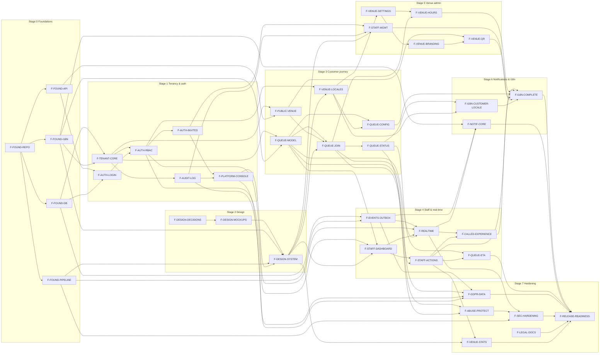
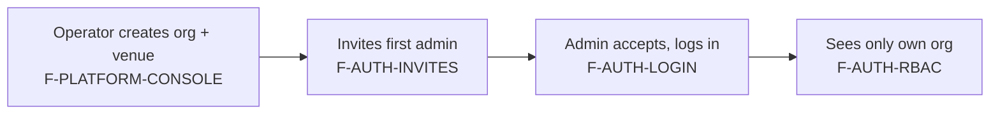
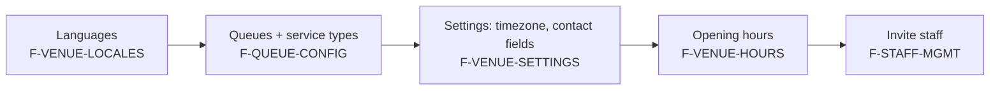
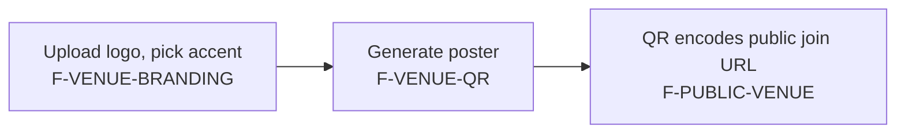
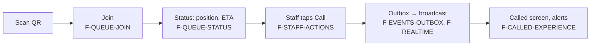
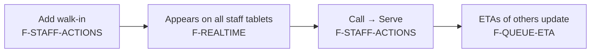
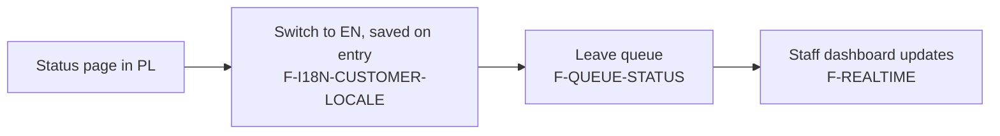
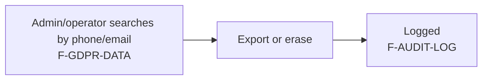

# Feature map

Features for v1.0, derived from [ROADMAP.md](ROADMAP.md). One feature is one unit that can be planned and delivered with a single plan.md. IDs are stable and never reused.

Status: `planned` · `in progress` · `done` · `dropped`

## Progress
Stage status: `not started` · `in progress` · `done`. A stage is `done` when all its features are `done`, its "Done when" in [ROADMAP.md](ROADMAP.md) is met and its demo script has been run.

| Stage | Features done | Status |
|---|---|---|
| 0: Foundations | 1 / 5 | in progress |
| 1: Tenancy, auth & operator console | 0 / 6 | not started |
| 2: Design foundations | 0 / 3 | not started |
| 3: Queue core & customer journey | 0 / 6 | not started |
| 4: Staff dashboard & real-time | 0 / 6 | not started |
| 5: Venue admin | 0 / 5 | not started |
| 6: Notifications & i18n completeness | 0 / 3 | not started |
| 7: Hardening, GDPR & handover | 0 / 6 | not started |
| **v1.0** | **1 / 40** | in progress |

## Next up
Work runs on two tracks. They don't block each other until a code feature depends on a product feature (e.g. F-DESIGN-SYSTEM needs F-DESIGN-MOCKUPS).

- **Code track:** features built in the repo, picked by dependency order.
- **Product track:** decisions and documents that need the product owner's time: design decisions, mockups and legal documents. Work on it starts when the product owner has time for it.

Plan states: `not started` → `drafted` → `approved` → `in implementation`.

| Track | Feature | Plan state | Plan |
|---|---|---|---|
| Code | F-FOUND-PIPELINE | approved | [plan](features/F-FOUND-PIPELINE/plan.md) |
| Product | F-DESIGN-DECISIONS | not started | – |
| Product | F-LEGAL-DOCS | not started | – |

## Features

### Stage 0: Foundations
| ID | Name | Status | Depends on | Description |
|---|---|---|---|---|
| F-FOUND-REPO | Repository & tooling | done | – | Strict TS, Tailwind, lint/format, Vitest, Playwright, layer-boundary checks, Conventional Commits via commitlint and a husky `commit-msg` hook |
| F-FOUND-PIPELINE | CI/CD & environments | planned | F-FOUND-REPO | GitHub Actions (including PR-title validation against Conventional Commits), Vercel `fra1` previews, Supabase staging/prod, gated migration job ([ADR-0009](adr/0009-gated-deploy-and-migration-pipeline.md)), `CRON_SECRET` (cron entry in F-EVENTS-OUTBOX), Sentry EU, uptime check (Sentry Uptime) |
| F-FOUND-DB | Database layer | planned | F-FOUND-REPO | Drizzle, schema `app`, migrations, local Supabase stack, pooler config; outbox table and a helper that writes a domain event in the caller's transaction |
| F-FOUND-API | API skeleton | planned | F-FOUND-REPO | Hono at `/api/v1`, problem+json errors, OpenAPI, `/health`; `Clock` port and shared Zod schemas for time formats (ISO 8601 UTC, dates, `HH:mm`, durations), `serverTime` in responses |
| F-FOUND-I18N | i18n foundation | planned | F-FOUND-REPO | next-intl, PL/EN catalogs, ICU plurals, **missing-key CI gate**, `LocalizedText` type and fallback resolver; date, time and relative-time formatters with an explicit `timeZone` |

### Stage 1: Tenancy, auth & operator console
| ID | Name | Status | Depends on | Description |
|---|---|---|---|---|
| F-TENANT-CORE | Tenant model & RLS | planned | F-FOUND-DB, F-FOUND-I18N | Organizations, venues (all columns, with defaults, including IANA `timezone` and `business_day_start`), DB roles, RLS policies, tenant-scoped transaction helper, cross-tenant isolation test harness (two seeded tenants) |
| F-AUTH-LOGIN | Staff authentication | planned | F-FOUND-API, F-FOUND-DB | Supabase Auth (password and magic link, EU SMTP), profiles, JWT verification, cookie and Bearer sessions |
| F-AUTH-RBAC | Roles & authorization | planned | F-TENANT-CORE, F-AUTH-LOGIN | Memberships, venue scope, permission map, authz middleware; per-endpoint generation of the cross-tenant isolation suite, covering all earlier endpoints too |
| F-AUDIT-LOG | Audit log | planned | F-TENANT-CORE | Append-only log of admin and operator actions |
| F-AUTH-INVITES | Invitations | planned | F-AUTH-RBAC | Create, send and accept invitations; expiry; role and venue scope |
| F-PLATFORM-CONSOLE | Operator console | planned | F-AUTH-INVITES, F-AUDIT-LOG | Platform admin role, create and suspend organizations and venues, invite the first admin, set retention days |

### Stage 2: Design foundations
| ID | Name | Status | Depends on | Description |
|---|---|---|---|---|
| F-DESIGN-DECISIONS | Design decisions | planned | – | Fill in every [DESIGN.md](DESIGN.md) decision: surfaces, branding, components, tokens, icons, fonts, accessibility, dark mode, called moment, text expansion |
| F-DESIGN-MOCKUPS | Clickable mockups | planned | F-DESIGN-DECISIONS | HTML mockups of join, status, called, staff dashboard, queue configuration, venue settings, QR poster; approved by the product owner |
| F-DESIGN-SYSTEM | Design system in code | planned | F-DESIGN-MOCKUPS, F-FOUND-I18N, F-FOUND-PIPELINE, F-PLATFORM-CONSOLE | Tokens (including a runtime `brand` token), fonts, icons, base components, light/dark, pseudo-locale, axe in CI, Stage 1 screens restyled |

### Stage 3: Queue core & customer journey
| ID | Name | Status | Depends on | Description |
|---|---|---|---|---|
| F-QUEUE-MODEL | Queue domain | planned | F-TENANT-CORE, F-FOUND-I18N | Queues, service types, entries, ticket counters per business day, entry events, state machine, routing, position, baseline ETA (ranges rounded to 5 minutes) |
| F-PUBLIC-VENUE | Public venue access | planned | F-TENANT-CORE, F-FOUND-API | Slug → tenant resolution (security definer), venue slug in the path on one shared domain, public venue endpoint, locale resolution for public pages |
| F-VENUE-LOCALES | Venue languages | planned | F-AUTH-RBAC, F-DESIGN-SYSTEM | Admin sets the venue's enabled locales and default locale (columns from F-TENANT-CORE); the first venue-admin screen and its navigation shell |
| F-QUEUE-CONFIG | Queue configuration | planned | F-QUEUE-MODEL, F-VENUE-LOCALES | Queues and service types CRUD with per-locale content |
| F-QUEUE-JOIN | Customer join | planned | F-QUEUE-MODEL, F-PUBLIC-VENUE, F-DESIGN-SYSTEM | Join page and endpoint, contact-field policy, consent capture, entry token, language switcher, basic per-IP rate limit; idempotency middleware and key store |
| F-QUEUE-STATUS | Customer status page | planned | F-QUEUE-JOIN | Status by token, position and ETA, polling, local token restore, leave |

### Stage 4: Staff dashboard & real-time
| ID | Name | Status | Depends on | Description |
|---|---|---|---|---|
| F-STAFF-DASHBOARD | Staff dashboard (read) | planned | F-QUEUE-MODEL, F-AUTH-RBAC, F-DESIGN-SYSTEM | Active entries per queue, overdue highlighting, tablet layouts |
| F-STAFF-ACTIONS | Staff queue actions | planned | F-STAFF-DASHBOARD, F-QUEUE-JOIN | Call, call next, recall, serve, no-show, remove, return; walk-ins; optimistic concurrency; undo; idempotent mutations (middleware from F-QUEUE-JOIN) |
| F-EVENTS-OUTBOX | Domain events & outbox | planned | F-FOUND-DB, F-FOUND-PIPELINE | `after()` dispatcher over the outbox table from F-FOUND-DB, Vercel Cron entry and the cron sweep endpoint (`CRON_SECRET` provisioned in F-FOUND-PIPELINE) |
| F-REALTIME | Real-time updates | planned | F-EVENTS-OUTBOX, F-AUTH-RBAC, F-STAFF-DASHBOARD, F-QUEUE-STATUS | Publisher interface, Supabase Broadcast, private channel authorization, client invalidation, polling fallback, connection indicator; `NotificationChannel` interface with the `status_page` channel |
| F-CALLED-EXPERIENCE | "You're called" | planned | F-REALTIME, F-STAFF-ACTIONS | Enable-alerts step, sound and vibration, wake lock, re-alerts, acknowledgement, staff fallback signals |
| F-QUEUE-ETA | Throughput ETA | planned | F-QUEUE-MODEL, F-STAFF-ACTIONS | Rolling throughput from entry events, ETA ranges, fallback to configured defaults |

### Stage 5: Venue admin
| ID | Name | Status | Depends on | Description |
|---|---|---|---|---|
| F-VENUE-SETTINGS | Venue settings | planned | F-VENUE-LOCALES | Timezone, business day start, contact-field policy, privacy notice URL |
| F-VENUE-BRANDING | Venue branding | planned | F-VENUE-SETTINGS | Logo upload (Supabase Storage), accent color with a contrast guard, applied to customer screens |
| F-VENUE-HOURS | Opening hours | planned | F-VENUE-SETTINGS, F-QUEUE-JOIN | Weekly hours as local wall-clock times (including hours past midnight), exceptions, joining blocked when the venue is closed, DST-safe |
| F-STAFF-MGMT | Staff management | planned | F-AUTH-INVITES, F-AUDIT-LOG, F-DESIGN-SYSTEM | Invite staff, change role and scope, disable |
| F-VENUE-QR | QR poster | planned | F-PUBLIC-VENUE, F-VENUE-BRANDING | Printable SVG/PDF poster (A4/A5) with the venue logo and join URL |

### Stage 6: Notifications & i18n completeness
| ID | Name | Status | Depends on | Description |
|---|---|---|---|---|
| F-NOTIF-CORE | Notification layer | planned | F-EVENTS-OUTBOX, F-REALTIME, F-FOUND-I18N | Notification policy, per-locale templates, delivery log, retries, `log` / `fake_sms` channels (on the interface from F-REALTIME), "near front" event |
| F-I18N-CUSTOMER-LOCALE | Customer locale persistence | planned | F-QUEUE-STATUS, F-VENUE-LOCALES | Change language mid-wait, saved on the entry, respects the venue's enabled locales |
| F-I18N-COMPLETE | Translation completeness | planned | F-CALLED-EXPERIENCE, F-STAFF-ACTIONS, F-VENUE-HOURS, F-QUEUE-CONFIG, F-STAFF-MGMT, F-VENUE-QR, F-I18N-CUSTOMER-LOCALE | Full PL/EN content pass across all screens and emails |

### Stage 7: Hardening, GDPR & handover
| ID | Name | Status | Depends on | Description |
|---|---|---|---|---|
| F-GDPR-DATA | PII retention & data-subject rights | planned | F-QUEUE-MODEL, F-EVENTS-OUTBOX, F-AUDIT-LOG, F-PLATFORM-CONSOLE | Nightly anonymization; find, export and erase by phone or email |
| F-ABUSE-PROTECT | Abuse protection | planned | F-QUEUE-JOIN, F-QUEUE-STATUS | Rate limits, optional Turnstile, active-entry caps per device or phone |
| F-SEC-HARDENING | Security hardening | planned | F-REALTIME, F-ABUSE-PROTECT, F-FOUND-PIPELINE | Security headers, CSP (Supabase wss, Sentry, Turnstile), CSRF and Origin checks, security review |
| F-LEGAL-DOCS | Legal documents | planned | – | DPA, subprocessor list, privacy notice template, versioned consent text |
| F-VENUE-STATS | Venue statistics | planned | F-STAFF-ACTIONS, F-DESIGN-SYSTEM | Served count, average wait, no-show rate |
| F-RELEASE-READINESS | v1.0 release readiness | planned | F-I18N-COMPLETE, F-NOTIF-CORE, F-QUEUE-ETA, F-GDPR-DATA, F-SEC-HARDENING, F-LEGAL-DOCS, F-VENUE-STATS | Enable point-in-time recovery, load test, restore drill, accessibility audit, alerting, runbook, go-live, tag `v1.0.0` |

**Total: 40 features.**

---

## Dependency graph

---

## Happy paths

All paths implicitly require the Stage 0 foundations, plus F-TENANT-CORE, F-AUTH-LOGIN and F-AUTH-RBAC. The lists show only the features that are specific to each journey, in build order.

### HP-1: Operator onboards a new restaurant
1. F-AUDIT-LOG
2. F-AUTH-INVITES
3. F-PLATFORM-CONSOLE: create the organization and venue, invite the admin
4. F-DESIGN-SYSTEM: restyled console

### HP-2: Venue admin sets up the venue and staff
1. F-VENUE-LOCALES
2. F-QUEUE-CONFIG
3. F-VENUE-SETTINGS
4. F-VENUE-HOURS
5. F-STAFF-MGMT

### HP-3: Venue admin prints the QR poster
1. F-PUBLIC-VENUE
2. F-VENUE-SETTINGS
3. F-VENUE-BRANDING
4. F-VENUE-QR

### HP-4: Customer joins and gets called
1. F-QUEUE-MODEL
2. F-QUEUE-CONFIG (the venue has queues)
3. F-PUBLIC-VENUE
4. F-QUEUE-JOIN
5. F-QUEUE-STATUS
6. F-STAFF-DASHBOARD
7. F-STAFF-ACTIONS
8. F-EVENTS-OUTBOX
9. F-REALTIME
10. F-CALLED-EXPERIENCE

### HP-5: Staff handles a walk-in from arrival to served
1. F-QUEUE-MODEL
2. F-QUEUE-JOIN (idempotency middleware)
3. F-STAFF-DASHBOARD
4. F-STAFF-ACTIONS
5. F-EVENTS-OUTBOX
6. F-REALTIME
7. F-QUEUE-ETA

### HP-6: Customer switches language and leaves
1. F-QUEUE-JOIN
2. F-QUEUE-STATUS
3. F-VENUE-LOCALES
4. F-I18N-CUSTOMER-LOCALE
5. F-REALTIME

### HP-7: Customer requests erasure of their data
1. F-AUDIT-LOG
2. F-PLATFORM-CONSOLE
3. F-GDPR-DATA

---

## Review findings

**Circular dependencies:** none in the graph as modeled.

The one place a cycle could appear is **F-REALTIME ↔ F-NOTIF-CORE**. The status page is both the realtime consumer and, from Stage 6, a notification channel. It's kept acyclic by having F-NOTIF-CORE wrap F-REALTIME, but see Q-1.

### Stage-order conflicts
| # | Conflict | Effect | Suggested resolution |
|---|---|---|---|
| C-1 | **Queues are needed in Stage 3, but F-QUEUE-CONFIG was in Stage 5** | – | **Resolved 2026-10-11:** F-QUEUE-CONFIG moved to Stage 3. Venue locales were split out of F-VENUE-SETTINGS into the new F-VENUE-LOCALES (Stage 3), which F-QUEUE-CONFIG depends on |
| C-2 | **The Stage 3 demo said "scan a QR code", but F-VENUE-QR is in Stage 5** | – | **Resolved 2026-10-11:** the Stage 3 demo opens the join link instead; QR comes only with the poster in Stage 5 |
| C-3 | **Missing-key CI gate:** ROADMAP Stage 6 lists it as "done when", but the baseline definition of done requires complete translations from Stage 0 | Inconsistent; untranslated strings could pile up | **Resolved 2026-10-11:** gate is in F-FOUND-I18N (Stage 0); ROADMAP Stage 0 and Stage 6 updated |
| C-4 | **Cron sweep:** ROADMAP puts "cron sweep and retries" in Stage 6, but realtime reliability (Stage 4) relies on the sweep, and F-GDPR-DATA needs cron | Lost broadcasts stay lost until Stage 6 (mitigated by polling) | **Resolved 2026-10-11:** cron infra and the outbox sweep are in F-EVENTS-OUTBOX (Stage 4); Stage 6 adds notification-specific retries. ROADMAP Stage 4 and Stage 6 updated |
| C-5 | **`LocalizedText` is needed in Stage 1** (`venues.name`) but the roadmap only introduces localized content later | Stage 1 would need a temporary plain-text name | **Resolved 2026-10-11:** placed in F-FOUND-I18N (Stage 0); ROADMAP Stage 0 updated |
| C-6 | **Venue settings are read from Stage 3 but editable later** | – | **Resolved 2026-10-11:** F-TENANT-CORE creates all venue settings columns with defaults; the operator sets the timezone at creation. F-VENUE-LOCALES and F-VENUE-SETTINGS are admin UI only |
| C-7 | **Branding is shown on customer screens (Stage 3) but configured in Stage 5** | – | **Resolved 2026-10-11:** F-DESIGN-SYSTEM provides a runtime `brand` token with a product default from day one |
| C-8 | **Staff accounts for the Stage 4 demo** come before F-STAFF-MGMT (Stage 5) | – | **Resolved 2026-10-11:** the admin role includes all staff permissions, and the operator can invite staff via F-AUTH-INVITES |
| C-9 | **Outbox:** CLAUDE.md requires every state change to write an outbox event, but the outbox was in F-EVENTS-OUTBOX (Stage 4), after the Stage 1 and Stage 3 state changes | – | **Resolved 2026-10-11:** F-FOUND-DB creates the outbox table and the in-transaction write helper; F-EVENTS-OUTBOX adds only the dispatcher and the cron sweep |
| C-10 | **Isolation suite:** every new endpoint must be covered, but the suite was generated only in F-AUTH-RBAC, after the first endpoints | – | **Resolved 2026-10-11:** F-TENANT-CORE provides the harness (two tenants, DB-level RLS tests); F-AUTH-RBAC adds per-endpoint generation and covers earlier endpoints |
| C-11 | **Idempotency** middleware was in F-FOUND-API, which has no database to store keys | – | **Resolved 2026-10-11:** moved to F-QUEUE-JOIN (the first public mutation, retried on weak mobile connections); F-STAFF-ACTIONS reuses it and now depends on F-QUEUE-JOIN |

### Questionable dependencies & risks
| # | Item | Note |
|---|---|---|
| Q-1 | **Realtime vs the notification layer** | **Resolved 2026-10-11:** the `NotificationChannel` interface and the `status_page` channel are in F-REALTIME (Stage 4); policy, templates, log and `fake_sms` stay in F-NOTIF-CORE (Stage 6) |
| Q-2 | **F-DESIGN-DECISIONS and F-DESIGN-MOCKUPS depend on nothing technical** | **Resolved 2026-10-11:** they run on the product track in "Next up", in parallel with Stages 0–1 |
| Q-3 | **F-LEGAL-DOCS has no dependencies but is consumed by F-QUEUE-JOIN** (consent text version) **and F-VENUE-SETTINGS** (privacy URL) | **Resolved 2026-10-11:** it runs on the product track from now on. Consent is recorded against a placeholder text until it's final, and the text must be final before any real customer data |
| Q-4 | **F-ABUSE-PROTECT is in Stage 7, but the public join endpoint exists from Stage 3** | **Resolved 2026-10-11:** F-QUEUE-JOIN includes a basic per-IP rate limit; Turnstile and per-device or per-phone caps stay in F-ABUSE-PROTECT |
| Q-5 | **Customer language switching is split** between F-QUEUE-JOIN (switcher, Stage 3) and F-I18N-CUSTOMER-LOCALE (persisting a mid-wait change, Stage 6) | **Resolved 2026-10-11:** intentional; ROADMAP Stage 3 and Stage 6 wording updated |
| Q-6 | **F-CALLED-EXPERIENCE "staff fallback signals"** | Depends on open question 16 (showing connection metadata to staff). Its scope is uncertain until that's decided |
| Q-7 | **F-VENUE-BRANDING adds Supabase Storage** (logo uploads), which isn't mentioned elsewhere | Same provider and region, so no new subprocessor. Still needs upload size and type limits and a storage RLS or signed-URL strategy |

---

## Keeping this file updated

- **Before writing a plan.md**, find the feature here (or add one) and save its plan as `docs/features/<feature-id>/plan.md` (from [`features/TEMPLATE.md`](features/TEMPLATE.md)), e.g. `docs/features/F-QUEUE-JOIN/plan.md`.
- **Update "Next up"** whenever a feature is closed or its plan changes state (`not started` → `drafted` → `approved` → `in implementation`). Keep at most one code-track item, plus the active product-track items.
- **Change the status** when work starts (`in progress`) and when the feature merges and meets the definition of done (`done`). Do it in the same PR.
- **Update "Progress"** in the same PR whenever a feature becomes `done` or `dropped` (a dropped feature leaves the count), and when a stage starts or is closed.
- **New or split features** get a new ID. IDs are never renamed or reused; a dropped feature is marked `dropped` instead of being deleted.
- **When dependencies change**, update the table, the Mermaid graph and any affected happy path together. Re-check the review findings if a feature moves between stages.
- **When a finding is resolved**, move it to a one-line note with the decision and date.
